<!-- Professional GitHub Profile Banner -->

  

---

<!-- Sachini Hansani | GitHub Profile README -->

# Hi, I'm Sachini Hansani! 👋

### 👩‍💻 Software Engineering Undergraduate
### 🚀 Aspiring Full-Stack Developer

**Passionate about Software Development, Technology & Continuous Learning**

📍 Sri Lanka | 🎓 NSBM Green University

---

## 👩‍💻 About Me

I'm **Sachini Hansani**, a Software Engineering undergraduate at **NSBM Green University, Sri Lanka**, aspiring to become a skilled **Full-Stack Developer**.

I'm passionate about designing and developing practical software applications, exploring modern technologies, and continuously improving my programming and problem-solving skills.

- 🎓 Studying **Software Engineering**
- 💻 Interested in **Full-Stack Web Development**
- 📱 Building applications using **Flutter and React Native**
- ⚙️ Exploring **Java, Spring Boot, and REST APIs**
- 🗄️ Working with **MySQL and Firebase**
- 🌱 Continuously learning and improving my development skills

---

## 🎯 Current Focus

I'm currently focusing on strengthening my software engineering skills through practical projects, continuous learning, and hands-on development.

- 🌐 **Full-Stack Development** - Developing my frontend and backend development skills to build complete applications.
- 📱 **Mobile Application Development** - Building interactive applications using Flutter, Dart, React Native, and Expo.
- ⚙️ **Backend Development** - Exploring Java, Spring Boot, REST APIs, and application architecture.
- 🗄️ **Database Integration** - Working with MySQL and Firebase to understand data management and CRUD operations.
- 🎨 **UI/UX Design** - Improving application layouts, usability, and responsive interface design.
- 🧪 **Software Quality** - Learning about application testing, debugging, clean code, and development best practices.

---

## 🛠️ Technical Stack

  Technologies and tools I use and explore while developing
  web applications, mobile applications, and backend systems.

### 💻 Programming Languages & Frontend Development

  

  
  
  
  
  
  
  
  

### ⚙️ Frameworks, Databases & Development Tools

  

  
  
  
  
  
  
  
  
  
  

---
